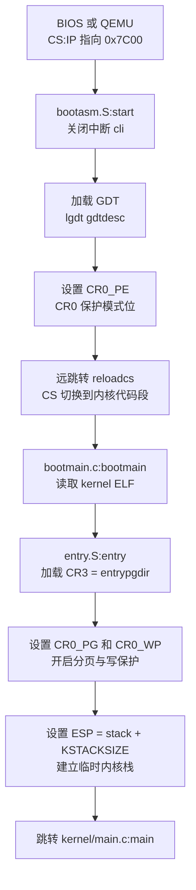
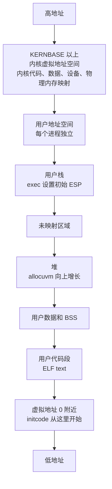
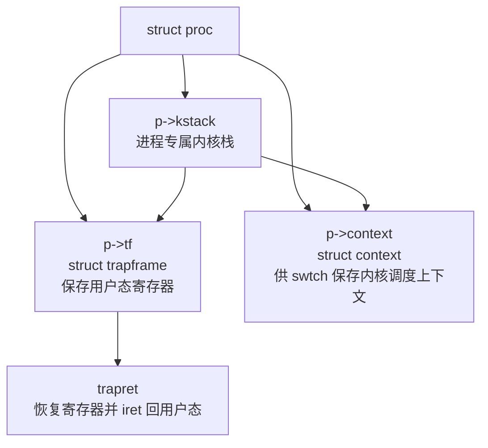
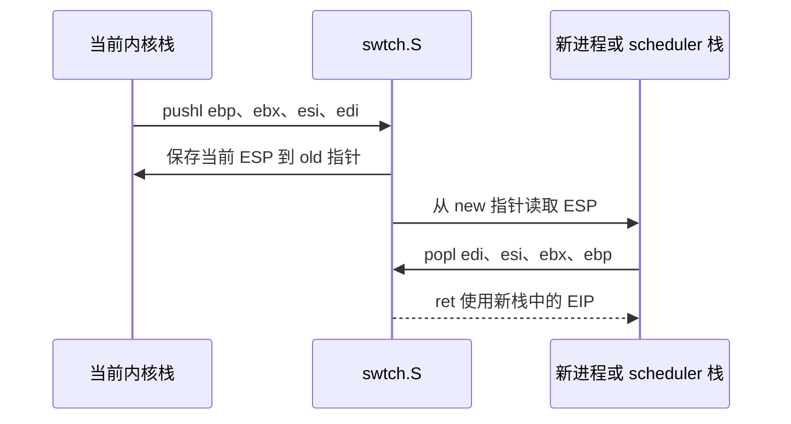
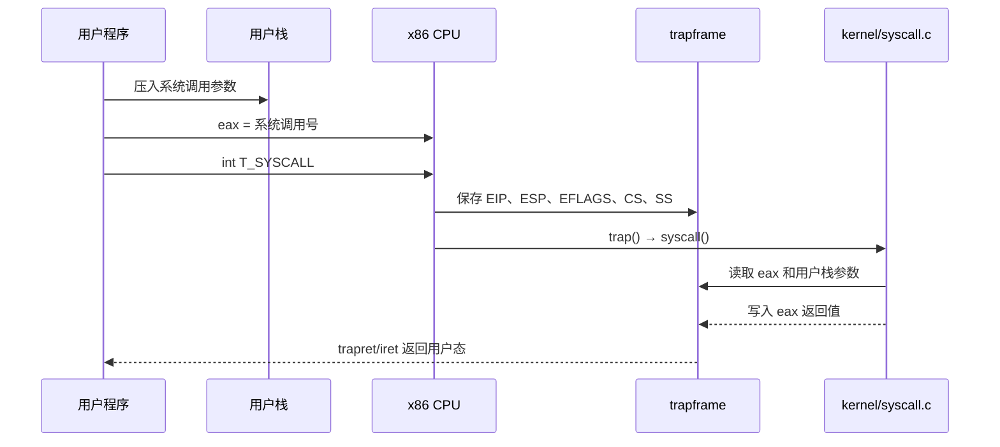

# xv6 x86 关键寄存器与内存结构图

本文把启动、分页、进程切换和系统调用中最容易混淆的寄存器与内存结构画出来。对应当前仓库的 x86 版本。

## 1. 启动阶段：从实模式到分页模式

对应文件：

```text
boot/bootasm.S
boot/bootmain.c
boot/entry.S
kernel/main.c
```



### 关键寄存器变化

| 阶段 | 关键寄存器 | 含义 |
|---|---|---|
| 刚进入启动扇区 | `CS:IP` | 指向物理地址 `0x7C00` |
| 加载 GDT 后 | `GDTR` | 指向全局描述符表 |
| 开启保护模式 | `CR0.PE = 1` | CPU 进入 32 位保护模式 |
| 设置临时页表 | `CR3 = entrypgdir` | 指向临时页目录 |
| 开启分页 | `CR0.PG = 1` | 虚拟地址开始经过页表转换 |
| 建立内核栈 | `ESP = stack + KSTACKSIZE` | 当前 CPU 的早期栈顶 |
| 进入 C 内核 | `EIP = main` | 开始执行内核 C 代码 |

## 2. 临时页表：低地址和内核高地址映射

`kernel/main.c` 中的 `entrypgdir` 使用 4 MB 大页，让启动代码在分页刚开启时仍能继续运行。

```mermaid
flowchart LR
    VA1[虚拟地址 0x00000000<br/>低地址映射]
    VA2[虚拟地址 KERNBASE<br/>通常为 0x80000000]
    PDE1[entrypgdir[0]<br/>PTE_P | PTE_W | PTE_PS]
    PDE2[entrypgdir[KERNBASE >> PDXSHIFT]<br/>PTE_P | PTE_W | PTE_PS]
    PA[物理地址 0x00000000<br/>4 MB 大页]

    VA1 --> PDE1 --> PA
    VA2 --> PDE2 --> PA
```

含义是：分页打开初期，同一段物理内存同时可以通过低地址和高地址访问。这样 `entry.S` 能从低地址代码继续跳到链接在高地址的内核入口。

相关代码：

```text
boot/entry.S
kernel/main.c: entrypgdir
kernel/mmu.h: PTE_PS、PTE_P、PTE_W
kernel/memlayout.h: KERNBASE、V2P、P2V
```

## 3. x86 两级页表地址转换

当前 xv6 使用 32 位 x86 两级页表：页目录 PDE 和页表 PTE。

```mermaid
flowchart LR
    V[32 位虚拟地址]
    DIR[高 10 位<br/>PDX(va)]
    TAB[中间 10 位<br/>PTX(va)]
    OFF[低 12 位<br/>页内偏移]
    PDE[页目录 PDE<br/>指向页表物理地址]
    PTE[页表 PTE<br/>指向物理页地址]
    PAGE[物理页基址]
    PA[物理地址<br/>物理页基址 + 页内偏移]

    V --> DIR --> PDE --> TAB --> PTE --> PAGE --> PA
    V --> OFF --> PA
```

地址结构：

```text
31                      22 21                      12 11          0
+-------------------------+--------------------------+-------------+
|       页目录索引        |        页表索引          |   页内偏移  |
+-------------------------+--------------------------+-------------+
          10 位                    10 位                 12 位
```

常用宏位于 `kernel/mmu.h`：

```c
PDX(va)       // 取页目录索引
PTX(va)       // 取页表索引
PTE_ADDR(pte) // 取物理页地址
PTE_FLAGS(pte)// 取权限和状态位
```

## 4. 内核和用户地址空间布局

对应文件：

```text
kernel/memlayout.h
kernel/vm.c
kernel/exec.c
```



对于当前 xv6，用户程序的初始地址空间由 `exec()` 建立，关键寄存器是：

```text
EIP = ELF header 中的 entry
ESP = 用户栈顶
CR3 = 当前进程的页目录物理地址
```

## 5. 进程控制块、内核栈和陷阱帧

对应文件：

```text
kernel/proc.h
kernel/proc.c
kernel/x86.h
kernel/trapasm.S
```

每个进程都有一个内核栈。进程从用户态进入内核态时，CPU 和汇编入口会在该栈上形成 `struct trapframe`。



### 陷阱帧的逻辑结构

```text
高地址
+-----------------------------+
| 用户态 SS                    |
| 用户态 ESP                   |
| EFLAGS                       |
| 用户态 CS                    |
| 用户态 EIP                   |
+-----------------------------+  CPU 进入内核时压入
| 错误码或占位                 |
| trapno                       |  trapasm.S 补充
| ds/es                        |
| edi, esi, ebp, oesp         |
| ebx, edx, ecx, eax          |
+-----------------------------+  tf 指针
低地址
```

`kernel/x86.h` 中的 `struct trapframe` 描述这个布局。`kernel/trap.c` 通过 `tf->eip`、`tf->esp`、`tf->eax` 等字段读取或修改用户态寄存器。

## 6. `swtch()` 上下文切换中的栈和寄存器

对应文件：

```text
kernel/swtch.S
kernel/proc.h: struct context
kernel/proc.c: scheduler、sched、yield
```

`swtch()` 不保存完整的用户寄存器，而是保存内核调度所需的被调用者保存寄存器和返回地址。



逻辑结构：

```text
struct context {
  uint edi;
  uint esi;
  uint ebx;
  uint ebp;
  uint eip;
};
```

注意：

- 用户态 `EIP/ESP/EFLAGS` 保存在 trap frame；
- 内核调度上下文保存在 `struct context`；
- 二者用途不同，不能混为一谈。

## 7. 系统调用时的寄存器和内存参数

对应文件：

```text
user/usys.S
kernel/trapasm.S
kernel/trap.c
kernel/syscall.c
```

当前 x86 版本使用：

```text
int T_SYSCALL
```

系统调用路径：



参数位置可以概括为：

```text
trapframe->eax       = 系统调用号，返回时也是返回值
trapframe->esp       = 用户态栈顶
用户栈 [esp + 4]     = 第 1 个系统调用参数
用户栈 [esp + 8]     = 第 2 个系统调用参数
```

`kernel/syscall.c` 中的 `argint()`、`argptr()` 和 `argstr()` 会通过用户进程页表检查并读取这些参数。

## 8. 文件描述符到磁盘块的存储关系

对应文件：

```text
kernel/sysfile.c
kernel/file.c
kernel/fs.c
kernel/bio.c
kernel/ide.c
```

```mermaid
flowchart LR
    FD[进程 p->ofile[fd]<br/>整数文件描述符]
    FILE[struct file<br/>类型、偏移、引用计数]
    INODE[struct inode<br/>设备号、inode 号、文件大小、块地址]
    CACHE[struct buf<br/>块缓存中的一个磁盘块]
    DISK[fs.img<br/>超级块、日志、inode、位图、数据块]

    FD --> FILE --> INODE --> CACHE --> DISK
```

例如执行：

```text
read(fd, buf, n)
```

大致路径是：

```text
fd
→ struct file
→ fileread()
→ readi()
→ bmap()
→ bread()
→ ideintr()/iderw()
→ fs.img 中的磁盘块
```

## 9. 学习时的寄存器追踪表

| 问题 | 优先观察的寄存器/结构 | 对应文件 |
|---|---|---|
| 分页何时开启 | `CR0`、`CR3` | `boot/entry.S`、`kernel/vm.c` |
| 当前执行到哪里 | `EIP` | `boot/bootmain.c`、`trapframe`、`context` |
| 当前使用哪个栈 | `ESP`、`EBP` | `boot/entry.S`、`proc.c`、`swtch.S` |
| 当前进程是谁 | `struct cpu.proc`、`myproc()` | `kernel/proc.c`、`kernel/proc.h` |
| 用户态如何回到内核 | `T_SYSCALL`、`trapframe` | `user/usys.S`、`kernel/trapasm.S` |
| 用户内存如何映射 | `CR3`、PDE、PTE | `kernel/vm.c`、`kernel/mmu.h` |
| 进程如何切换 | `struct context`、ESP、EIP | `kernel/swtch.S`、`kernel/proc.c` |
| 文件如何找到磁盘数据 | `fd`、`struct file`、`struct inode` | `kernel/file.c`、`kernel/fs.c` |

## 10. 建议的图示阅读顺序

```text
1. 启动寄存器图
   理解 CR0、CR3、ESP、EIP 的初始变化

2. 临时页表和两级页表图
   理解虚拟地址如何变成物理地址

3. 进程内存和内核栈图
   区分用户地址空间、trapframe 和 context

4. 系统调用时序图
   理解 int、trap、syscall 和返回值 eax

5. 文件描述符存储关系图
   理解用户看到的 fd 如何连接到磁盘块
```

后续分析代码时，可以先在图中定位对象，再进入对应源码。例如分析 `fork()` 时，先看 `struct proc`、页表和内核栈，再阅读 `kernel/proc.c` 的具体实现。
