# xv6 x86 启动流程瀑布图

本文按照当前仓库的 x86 版本，描述从“机器加电”到“xv6 Shell 出现”的主要过程。

> 说明：BIOS、QEMU 和 CPU 上电动作发生在 xv6 之外；从 `boot/bootasm.S` 开始才进入本仓库的启动代码。

## 1. 总体瀑布流

```mermaid
flowchart TD
    A["设备加电 / QEMU 启动虚拟机"]
    B["BIOS 或虚拟 BIOS 初始化硬件"]
    C["从启动磁盘读取第 0 扇区<br/>加载到物理地址 0x7C00"]
    D["boot/bootasm.S<br/>start:<br/>关中断、设置段寄存器、进入 32 位保护模式"]
    E["boot/bootmain.c<br/>bootmain()<br/>从磁盘读取 kernel ELF"]
    F["解析 kernel ELF program headers<br/>将各段加载到指定物理地址"]
    G["跳转到 ELF entry<br/>boot/entry.S: entry"]
    H["boot/entry.S<br/>建立临时页表 entrypgdir<br/>打开分页、设置栈"]
    I["kernel/main.c: main()<br/>进入内核 C 代码"]
    J["初始化 CPU 和内存基础设施<br/>mpinit / lapicinit / kinit1 / kvmalloc / seginit"]
    K["初始化中断和设备<br/>picinit / ioapicinit / consoleinit / uartinit<br/>tvinit / idtinit / ideinit"]
    L["初始化内核对象<br/>pinit / binit / fileinit / iinit"]
    M["启动其他 CPU<br/>kernel/main.c: startothers()<br/>boot/entryother.S: start"]
    N["当前 CPU 进入 mpmain()<br/>开启中断、完成 kinit2、切换完整页表"]
    O["kernel/proc.c: userinit()<br/>建立第一个用户进程"]
    P["将 boot/initcode.S 编译出的 initcode<br/>放入第一个进程地址空间"]
    Q["调度器 scheduler()<br/>选择 RUNNABLE 的 initcode 进程"]
    R["返回用户态执行 initcode.S<br/>通过 exec(/init) 进入用户程序"]
    S["user/init.c: main()<br/>fork() 后 exec(sh)"]
    T["user/sh.c: main()<br/>显示 Shell 提示符并等待命令"]

    A --> B --> C --> D --> E --> F --> G --> H --> I
    I --> J --> K --> L --> M --> N --> O --> P --> Q --> R --> S --> T
```



## 2. 阶段一：设备加电到 Bootloader

### 2.1 设备加电

```text
真实机器或 QEMU
    ↓
BIOS / 虚拟 BIOS
    ↓
读取启动磁盘第 0 扇区
    ↓
将启动扇区放到物理地址 0x7C00
    ↓
跳转到 0x7C00 执行 bootblock
```

这部分不是 xv6 C 代码，而是 BIOS/QEMU 的职责。xv6 的 `Makefile` 会把以下两个文件链接、转换成启动扇区：

```text
boot/bootasm.S
boot/bootmain.c
```

生成过程：

```text
boot/bootasm.S + boot/bootmain.c
    ↓
bootblock.o
    ↓
objcopy 提取代码段
    ↓
bootblock
    ↓
tools/sign.pl 添加 0xAA55 启动签名
    ↓
xv6.img 的第 0 扇区
```

### 2.2 `boot/bootasm.S`

入口函数：

```asm
start:
```

主要工作：

1. 关闭中断；
2. 清理和设置 x86 段寄存器；
3. 通过 GDT 从 16 位实模式进入 32 位保护模式；
4. 设置临时栈；
5. 调用 `bootmain()`。

调用关系：

```text
BIOS 跳转到 0x7C00
    → boot/bootasm.S: start
    → boot/bootmain.c: bootmain
```

## 3. 阶段二：Bootloader 加载内核

### 3.1 `boot/bootmain.c`

入口函数：

```c
bootmain(void)
```

主要工作：

1. 从磁盘读取内核 ELF 头；
2. 检查 ELF 魔数；
3. 遍历 program header；
4. 将每个 ELF 段从磁盘复制到目标物理地址；
5. 读取 ELF 的入口地址；
6. 跳转到内核入口。

调用关系：

```text
bootasm.S: start
    → bootmain()
    → readseg()
    → 读取 xv6.img 中的 kernel
    → 根据 ELF program headers 装载内核段
    → entry()
```

内核不是由 `bootmain.c` 直接调用 `main()`，而是先跳转到 ELF 入口，也就是 `boot/entry.S` 中的 `entry`。

## 4. 阶段三：进入保护模式分页内核

### 4.1 `boot/entry.S`

入口：

```asm
entry:
```

主要工作：

1. 设置临时页目录 `entrypgdir`；
2. 建立低地址和内核高地址映射；
3. 将页目录地址写入 `cr3`；
4. 设置 `cr0`，打开分页；
5. 设置内核栈；
6. 跳转到 `main()`。

关键关系：

```text
boot/entry.S
    ├─ 使用 kernel/main.c 中的 entrypgdir
    ├─ 使用 boot/kernel.ld 定义的链接地址
    └─ 跳转到 kernel/main.c: main
```

### 4.2 `boot/kernel.ld`

链接脚本决定：

- 内核代码段地址；
- 数据段地址；
- BSS 段地址；
- 内核入口地址；
- `initcode` 和 `entryother` 二进制内容在内核中的符号位置。

因此 `kernel.ld` 不执行代码，但决定了 `bootmain.c` 加载后的内核内存布局。

## 5. 阶段四：内核 C 入口和基础初始化

### 5.1 `kernel/main.c: main()`

内核进入 C 语言后的总入口是：

```c
main(void)
```

典型初始化顺序如下：

```text
main()
 ├─ mpinit()       识别多处理器信息
 ├─ lapicinit()    初始化当前 CPU 的 Local APIC
 ├─ kinit1()       初始化早期物理页分配器
 ├─ kvmalloc()     建立内核页表
 ├─ seginit()      设置当前 CPU 的段寄存器
 ├─ picinit()      初始化传统 PIC
 ├─ ioapicinit()   初始化 I/O APIC
 ├─ consoleinit()  初始化控制台和键盘输入
 ├─ uartinit()     初始化串口
 ├─ pinit()        初始化进程表
 ├─ tvinit()       初始化中断描述符表
 ├─ binit()        初始化块缓存
 ├─ fileinit()     初始化文件表
 ├─ ideinit()      初始化 IDE 磁盘
 ├─ startothers()  启动其他 CPU
 ├─ kinit2()       完成剩余物理内存初始化
 ├─ userinit()     创建第一个用户进程
 └─ mpmain()       进入每个 CPU 的内核主流程
```

### 5.2 对应文件

| 初始化动作 | 文件 | 作用 |
|---|---|---|
| 多处理器发现 | `kernel/mp.c`、`kernel/mp.h` | 找到 CPU 和 APIC 信息 |
| Local APIC | `kernel/lapic.c` | 当前 CPU 的本地中断控制 |
| 物理内存分配 | `kernel/kalloc.c` | 分配和释放物理页 |
| 内核页表 | `kernel/vm.c` | 建立内核虚拟地址空间 |
| 分段 | `kernel/vm.c`、`kernel/x86.h` | 设置 x86 段寄存器和 GDT |
| PIC | `kernel/picirq.c` | 初始化旧式中断控制器 |
| I/O APIC | `kernel/ioapic.c` | 将设备中断路由到 CPU |
| 控制台 | `kernel/console.c`、`kernel/kbd.c` | 键盘输入和屏幕输出 |
| 串口 | `kernel/uart.c` | 串口输出 |
| 中断表 | `kernel/trap.c`、`kernel/vectors.S` | 建立中断入口 |
| 块缓存 | `kernel/bio.c`、`kernel/buf.h` | 缓存磁盘块 |
| 文件表 | `kernel/file.c` | 管理全局文件对象 |
| IDE 磁盘 | `kernel/ide.c` | 读写磁盘块 |
| 进程表 | `kernel/proc.c` | 初始化进程管理结构 |

## 6. 阶段五：启动其他 CPU

### 6.1 `kernel/main.c: startothers()`

Bootstrap Processor，也就是最初启动的 CPU，会执行：

```c
startothers()
```

主要工作：

1. 将 `entryother.S` 复制到低地址内存 `0x7000`；
2. 为每个 AP 设置独立的内核栈；
3. 将页表地址、栈地址和入口地址写入启动代码；
4. 通过 Local APIC 发送启动信号。

### 6.2 `boot/entryother.S`

其他 CPU 从：

```asm
start:
```

开始执行，完成与 `entry.S` 类似的基础工作：

- 进入保护模式；
- 加载临时页表；
- 设置自己的内核栈；
- 调用 `mpmain()`。

```text
kernel/main.c: startothers()
    → 复制 boot/entryother.S
    → 启动 AP
    → boot/entryother.S: start
    → kernel/main.c: mpmain
```

## 7. 阶段六：中断、页表和调度器就绪

### 7.1 `kernel/main.c: mpmain()`

每个 CPU 最终进入：

```c
mpmain(void)
```

主要工作：

```text
mpmain()
 ├─ cprintf()       输出 CPU 启动信息
 ├─ idtinit()       加载当前 CPU 的 IDT
 ├─ xchg()          设置 cpu->started
 ├─ kinit2()        完成剩余内存页初始化
 ├─ switchkvm()     切换到完整内核页表
 ├─ userinit()      仅由启动 CPU 创建第一个用户进程
 └─ scheduler()     进入调度循环
```

### 7.2 中断准备

中断相关调用链：

```text
boot/vectors.pl
    → 生成 vectors.S
    → kernel/trap.c: tvinit()
    → kernel/trapasm.S: alltraps
    → kernel/trap.c: trap()
```

硬件或软件事件最终进入 `trap()`，包括：

- 系统调用；
- 时钟中断；
- 键盘中断；
- 磁盘中断；
- 页错误和其他 CPU 异常。

## 8. 阶段七：创建第一个用户进程

### 8.1 `kernel/proc.c: userinit()`

第一个用户进程不是直接从 `user/init.c` 开始，而是由内核创建一个最小进程：

```c
userinit(void)
```

主要过程：

```text
userinit()
 ├─ allocproc()              分配进程控制块
 ├─ setupkvm()               创建用户页表
 ├─ inituvm()                将 initcode 放入用户地址 0
 ├─ p->sz = PGSIZE           设置初始地址空间大小
 ├─ 设置 trap frame
 ├─ p->state = RUNNABLE      放入可运行队列
 └─ p->name = "initcode"
```

### 8.2 `boot/initcode.S`

`initcode.S` 是第一个用户态程序，体积极小。它做两件事：

1. 设置系统调用参数；
2. 调用 `exec("/init")`。

```text
kernel/proc.c: userinit()
    → kernel/vm.c: inituvm()
    → 将 initcode 放入进程地址空间
    → scheduler() 选中进程
    → 返回用户态
    → boot/initcode.S
    → exec("/init")
```

`initcode.S` 中的系统调用会经过：

```text
boot/initcode.S
    → int T_SYSCALL
    → kernel/trapasm.S
    → kernel/trap.c: trap()
    → kernel/syscall.c: syscall()
    → kernel/sysfile.c: sys_exec()
    → kernel/exec.c: exec()
```

## 9. 阶段八：从 init 到 Shell

### 9.1 `user/init.c`

`exec("/init")` 加载 `user/init.c` 编译出的用户程序。

进入：

```c
user/init.c: main()
```

它负责：

1. 打开控制台；
2. 将标准输入、标准输出和标准错误连接到控制台；
3. 循环创建 Shell 子进程；
4. 等待 Shell 退出后重新启动 Shell。

调用关系：

```text
initcode.S
    → exec("/init")
    → kernel/exec.c: exec()
    → user/init.c: main()
    → fork()
    → exec("sh")
```

### 9.2 `user/sh.c`

Shell 进入：

```c
user/sh.c: main()
```

然后等待输入命令，例如：

```sh
ls
```

基本调用链：

```text
user/sh.c: main()
    → gets()
    → parsecmd()
    → fork1()
    → runcmd()
    → exec("ls")
    → user/ls.c: main()
```

至此，系统完成了从加电到用户 Shell 的启动过程。

## 10. 一张简化调用链

```text
设备加电
  ↓
BIOS/QEMU
  ↓
0x7C00
  ↓
boot/bootasm.S:start
  ↓
boot/bootmain.c:bootmain
  ↓
读取 xv6.img 中的 kernel ELF
  ↓
boot/entry.S:entry
  ↓
打开分页、设置内核栈
  ↓
kernel/main.c:main
  ↓
初始化 CPU、内存、中断、设备、进程和文件系统
  ↓
kernel/main.c:startothers
  ↓
boot/entryother.S:start
  ↓
kernel/main.c:mpmain
  ↓
kernel/proc.c:userinit
  ↓
boot/initcode.S
  ↓
exec("/init")
  ↓
user/init.c:main
  ↓
exec("sh")
  ↓
user/sh.c:main
  ↓
Shell 提示符
```

## 11. 阅读顺序建议

第一次阅读启动流程时，建议按以下顺序打开文件：

```text
1. Makefile
2. boot/bootasm.S
3. boot/bootmain.c
4. boot/entry.S
5. boot/kernel.ld
6. kernel/main.c
7. kernel/vm.c
8. kernel/proc.c
9. boot/entryother.S
10. boot/initcode.S
11. kernel/trapasm.S
12. kernel/trap.c
13. kernel/syscall.c
14. kernel/exec.c
15. user/init.c
16. user/sh.c
```

## 12. 关键理解点

### 12.1 Bootloader 不等于内核

```text
bootblock
    └─ 负责把 kernel 从磁盘搬到内存并跳转

kernel
    └─ 负责初始化硬件、管理进程、内存、文件和系统调用
```

### 12.2 `initcode.S` 不等于 `init.c`

```text
initcode.S
    └─ 第一个极小用户程序，只负责 exec("/init")

init.c
    └─ 第一个正式用户程序，负责启动 Shell
```

### 12.3 `main()` 有多个层次

阅读时要注意它们不是同一个函数：

```text
kernel/main.c: main()   内核启动入口
user/init.c: main()     第一个正式用户程序
user/sh.c: main()       Shell 入口
user/ls.c: main()       ls 用户程序入口
```

### 12.4 `exec()` 不创建进程

```text
fork()  创建或复制一个进程
exec()  用新程序替换当前进程的地址空间
wait()  等待子进程结束
```

Shell 通常使用：

```text
fork()
    → 子进程 exec()
    → 父进程 wait()
```

### 12.5 启动过程结束的标志

当看到 Shell 提示符时，至少说明以下组件已经工作：

- Bootloader 已经加载内核；
- CPU 已经进入保护模式和分页模式；
- 内核页表已建立；
- 中断系统已初始化；
- 进程调度器已运行；
- 用户地址空间已建立；
- `exec()` 已经能够加载 ELF 用户程序；
- 文件系统和控制台已经可用；
- `init` 已经成功启动 Shell。
